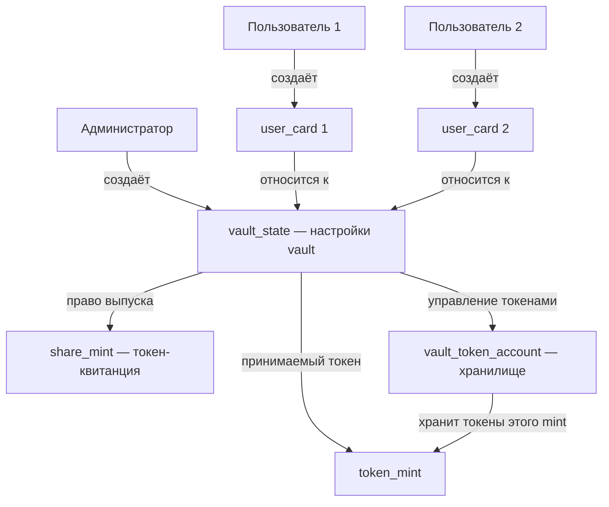

# Неделя 8 — схема аккаунтов

| Аккаунт | Что хранит | Программа-владелец / право управления |
|---|---|---|
| `vault_state` | `admin`, `token_mint`, `vault_token_account`, `share_mint`, `bump` | `simple_vault` |
| `token_mint` | Параметры принимаемого токена: точность, объём выпуска, полномочия | SPL Token Program / право выпуска у администратора |
| `share_mint` | Параметры токена-квитанции, точность 6 знаков | SPL Token Program / право выпуска у PDA `vault_state` |
| `vault_token_account` | Адрес mint, баланс токенов, authority | SPL Token Program / authority — PDA `vault_state` |
| `user_card` | `vault`, `owner`, `bump` | `simple_vault` / `owner` указывает пользователя |

## Explorer — devnet

| Объект | Адрес |
|---|---|
| Программа | [BSBHGpeTSSp3jEHdhaWUnBPVTgBok63je37evskejiWh](https://explorer.solana.com/address/BSBHGpeTSSp3jEHdhaWUnBPVTgBok63je37evskejiWh?cluster=devnet) |
| Администратор | [HMg9Wz3DLAwU8GAYh91WhRMWQzdhpAsBpUYkZcf9tMtX](https://explorer.solana.com/address/HMg9Wz3DLAwU8GAYh91WhRMWQzdhpAsBpUYkZcf9tMtX?cluster=devnet) |
| Настройки vault | [56vh4TPixvM6CiCsYE39ymrbkaTTDJGC8pjd72EsarDF](https://explorer.solana.com/address/56vh4TPixvM6CiCsYE39ymrbkaTTDJGC8pjd72EsarDF?cluster=devnet) |
| Принимаемый токен | [7uYsEKKE8SJQD8fnVBvT2tQzAhUdVznxiWmCXUMhzswG](https://explorer.solana.com/address/7uYsEKKE8SJQD8fnVBvT2tQzAhUdVznxiWmCXUMhzswG?cluster=devnet) |
| Share-токен | [DhyN318Kvde6wL4howL1TDaj6VuAjwoJaLXY57Tx561C](https://explorer.solana.com/address/DhyN318Kvde6wL4howL1TDaj6VuAjwoJaLXY57Tx561C?cluster=devnet) |
| Хранилище токенов | [2oMFmRFTUfLvvnrF2UzJvKYNRMFSXNzX5tX4wYKthyds](https://explorer.solana.com/address/2oMFmRFTUfLvvnrF2UzJvKYNRMFSXNzX5tX4wYKthyds?cluster=devnet) |
| Карточка пользователя 1 | [87uzVf9cCe2T1auRQWpipeCyFBXuHjwKnbLb1QmYpops](https://explorer.solana.com/address/87uzVf9cCe2T1auRQWpipeCyFBXuHjwKnbLb1QmYpops?cluster=devnet) |
| Пользователь 1 | [5A2ML7SncTkaTcRTewvJehAZBKKUyjYLjZ1PHCgnJBGX](https://explorer.solana.com/address/5A2ML7SncTkaTcRTewvJehAZBKKUyjYLjZ1PHCgnJBGX?cluster=devnet) |
| Карточка пользователя 2 | [CUZe1gVGUFaHtNQFCULfLNUf7qXCc1Ym2rsa7rePMTER](https://explorer.solana.com/address/CUZe1gVGUFaHtNQFCULfLNUf7qXCc1Ym2rsa7rePMTER?cluster=devnet) |
| Пользователь 2 | [93iuc4Zig1WcHotLcTen2MXhAcwBtAajb5EN1sQ2HzTp](https://explorer.solana.com/address/93iuc4Zig1WcHotLcTen2MXhAcwBtAajb5EN1sQ2HzTp?cluster=devnet) |
